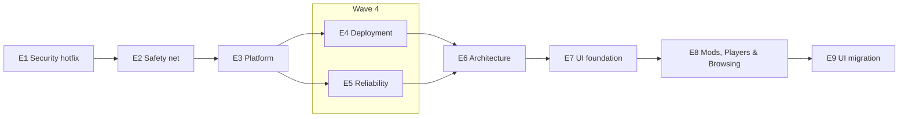

# Music Party rework roadmap

An incremental, strangler-style rework of Music Party on `feature/v3-rewrite`, starting from `develop` @ ce3af63. Every merge leaves the app deployable with every v2 feature intact. The failed from-scratch rewrite is archived at tag `archive/v3-rewrite` and is reference material only; nothing is cherry-picked from it by default.

## Source of truth

`docs/specs/` is the source of truth for scope. Each epic has one PRD here.

- Each epic GitHub issue carries the `epic` label (never `ready-for-agent`), a short summary and a link to its PRD.
- Sub-issues are created from the PRD with `/to-tickets` and link back to it.
- To change scope, change the PRD first, then update the issues. An issue that disagrees with its PRD is wrong.
- Domain terms follow `GLOSSARY.md`. Architectural decisions live in `docs/adr/`.

## Functionality baseline

All functionality on `develop` @ ce3af63 is retained unless a PRD explicitly removes it. That includes the YouTube and TV pages, moderation (Blocklist rules), the VIP role, request limits, themes, the admin pages, impersonation, multiple social logins and email account merge.

## Epics

Waves: E1 → E2 → E3 → (E4 ∥ E5) → E6 → E7 → E8 → E9. E4 ∥ E5 is the only parallel pair.

| ID | Title | PRD | Wave | blocked_by |
|---|---|---|---|---|
| E1 | Security hotfix | [E01-security-hotfix.md](E01-security-hotfix.md) | 1 | none |
| E2 | Safety net | [E02-safety-net.md](E02-safety-net.md) | 2 | E1 |
| E3 | Platform | [E03-platform.md](E03-platform.md) | 3 | E2 |
| E4 | Deployment | [E04-deployment.md](E04-deployment.md) | 4 | E3 |
| E5 | Reliability | [E05-reliability.md](E05-reliability.md) | 4 | E3 |
| E6 | Architecture | [E06-architecture.md](E06-architecture.md) | 5 | E4, E5 |
| E7 | UI foundation | [E07-ui-foundation.md](E07-ui-foundation.md) | 6 | E6 |
| E8 | Mods, Players & Browsing | [E08-mods-players-browsing.md](E08-mods-players-browsing.md) | 7 | E7 |
| E9 | UI migration | [E09-ui-migration.md](E09-ui-migration.md) | 8 | E8 |

## Dependency graph

## Concurrency rule

- Dependent epics never run at the same time. An epic starts only when every epic in its `blocked_by` list is merged into `feature/v3-rewrite`.
- Epics only see each other's work once it is merged. Epics in the same wave run in parallel and must not depend on each other's unmerged changes.
- Epic-level `blocked_by` edges on the GitHub issues enforce the waves. Tickets inside an epic carry their own `blocked_by` edges, listed in each PRD's ticket slices.
- Each epic works on its own `epic/*` branch cut from `feature/v3-rewrite` and merges back when its acceptance criteria hold. Never rebase onto `main`/`origin/HEAD`.

## Working rules

- Every ticket ships a deployable app with all v2 features working.
- Pest tests accompany every change (from E2 onwards on the E2 harness). CI must be green before merge.
- PHPStan level 8 baseline may only shrink; new code adds no new errors.
- First-party Laravel packages are preferred; anything else needs an ADR.
- Rename toward glossary terms only where code is already being touched.
